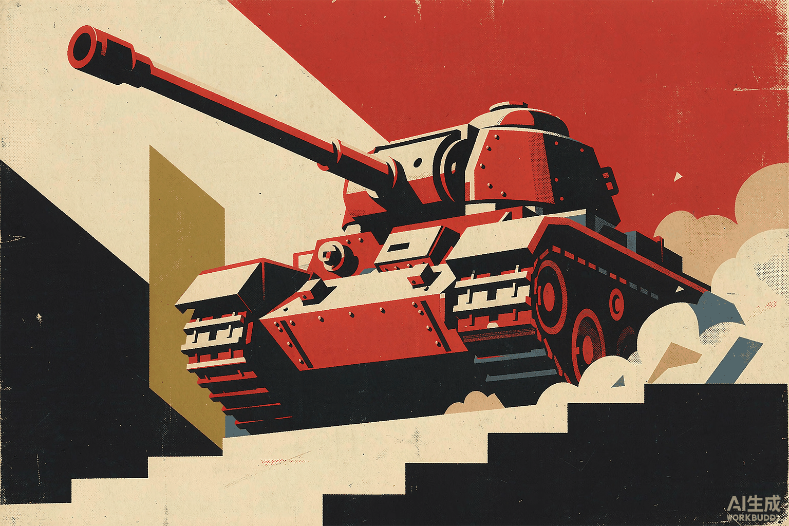
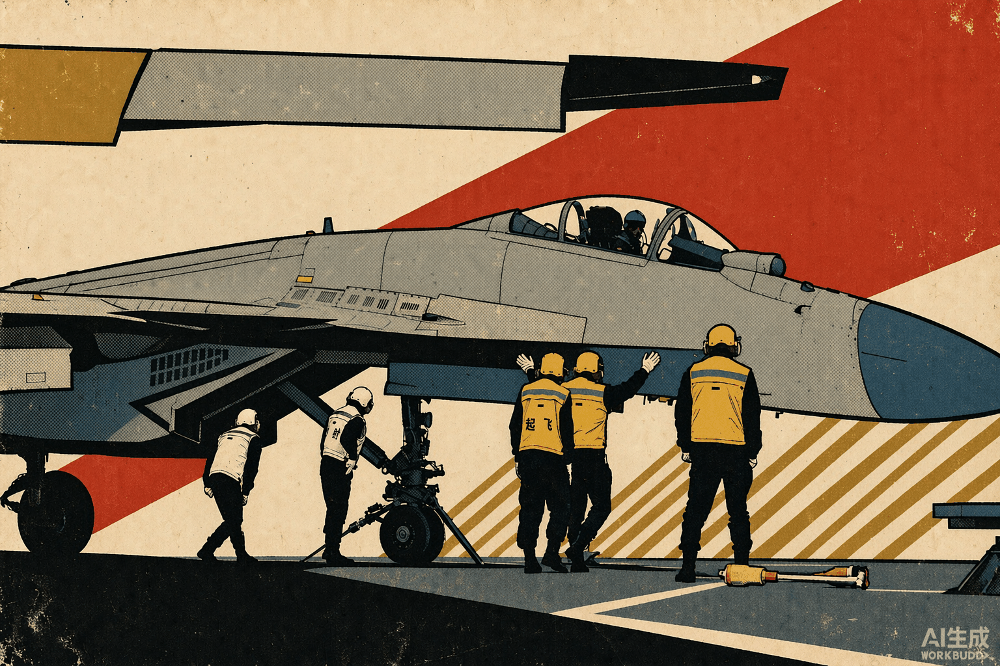
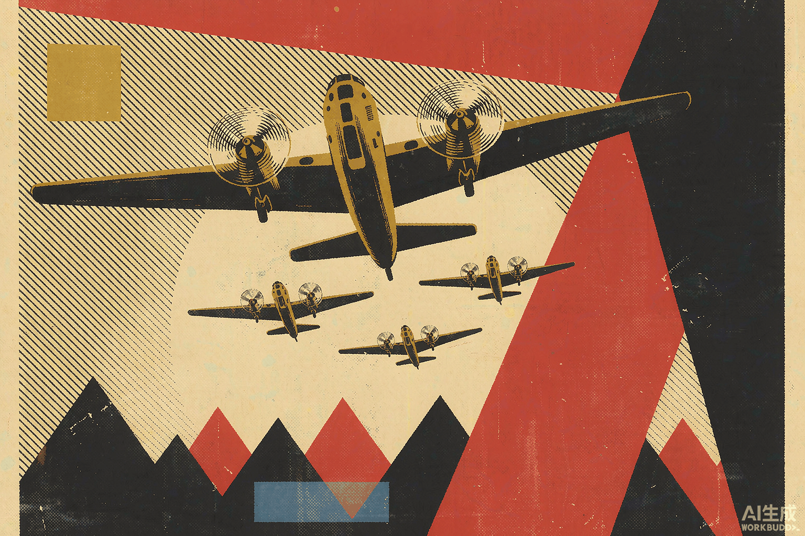

# 军构美学 · military-aesthetic

> 把一张实拍照片，重构成 1930 年代苏联构成主义军事宣传画风格的海报。
> 主体姿态照旧，整个背景换成几何构成。


---

## 效果

<table>
<tr>
<td width="33%"></td>
<td width="33%"></td>
<td width="33%"></td>
</tr>
<tr>
<td align="center"><sub>坦克 · 斜切阶梯（BG-2）</sub></td>
<td align="center"><sub>舰载机 · 实拍照片转海报</sub></td>
<td align="center"><sub>轰炸机编队 · 平行线束（BG-3）</sub></td>
</tr>
</table>

---

## 目录

- [它解决什么问题](#它解决什么问题)
- [它不是什么](#它不是什么)
- [风格规格](#风格规格)
- [三条红线](#三条红线)
- [工作流](#工作流)
- [背景方案库](#背景方案库)
- [Prompt 片段](#prompt-片段)
- [故障速查](#故障速查)
- [目录结构](#目录结构)
- [安装与使用](#安装与使用)
- [能力边界](#能力边界)
- [开源许可](#开源许可)

---

## 它解决什么问题

把一张随手拍的装备照片变成能当海报用的图，常见做法是加滤镜、调色、套边框——结果是照片还是那张照片，只是脏了。

军构美学走另一条路：**保留照片的信息，重建照片的语法**。

- **主体照原样**：`input_fidelity: high`，机身结构、地勤手势、装备折叠状态、场景关系一律不跑偏
- **背景整个拿掉**：天空、墙面、杂乱背景被米白纸底上切开的朱红斜楔、黑色阶梯、工业剪影与平行斜线束取代

出来的不是"加了滤镜的照片"，是一张**本来就没存在过的宣传画**。

## 它不是什么

| 它不是 | 它是 |
|--------|------|
| 套滤镜 / 调色 | 重构构图，背景整体替换为几何构成 |
| 复刻照片上的文字编号 | 编号一律处理成纯色块 |
| 自由发挥的二创 | 主体内容严格守住原片 |
| 通用文生图 | 锁定五色、锁定几何语言、锁定反旭日禁令 |

---

## 风格规格

### 调色板（五色封顶）

| 角色 | 色值 | 用途 |
|:-----|:-----|:-----|
| 纸底 | `#EFE5D2` | 暖米白，背景主体色，占画面最大面积 |
| 朱红 | `#D22B1E` | 斜楔形、装备主色、强调块 |
| 墨黑 | `#16130F` | 轮廓线、剪影、大色块 |
| 赭金 | `#C79131` | 金属受光面、平行线束、点睛矩形 |
| 钴蓝 | `#3E6E8C` | 点睛：海面、天空、机械阴影面（≤10%） |

> 平涂无渐变，同一块面只允许一个颜色。层次靠**色块并置**，不靠明暗过渡。

### 造型与线条

- 粗黑墨线勾勒主体轮廓，笔触偏钢笔速写，允许略有抖动
- 关键结构加粗，细节处收细，不是均匀描边
- 背景辅助线用**同向平行的细线**，绝不用从一点发散的射线

### 几何语言

| 元素 | 说明 |
|:-----|:-----|
| 斜切色块 | 1–2 条粗大斜带/楔形切开画面，构成主义的核心动作 |
| 阶梯几何 | 阶梯、梯田、层叠台阶，沿下缘或侧边排布 |
| 工业剪影 | 烟囱、塔吊、水塔、屋顶天际线，纯黑剪影压纸底 |
| 平行斜线束 | 一组同向平行细线作节奏纹理 |
| 透视网格 | 向消失点收敛的黑红米白方格面板 |
| 几何山形 | 尖锐三角形层叠山峦（自然题材用） |

### 印刷质感

胶印/丝网印网点（色块边缘可见）· 纸纹颗粒贯穿全图 · 套色轻微错位（红黑边界 1–2px）· 磨损斑与边缘泛黄

> 做旧不能盖过可读性。纸底过脏会让画面从"复古"变成"脏"。

---

## 三条红线

### 1. 禁止旭日旗语言（一票否决）

**任何从单一点向外扩散的放射状线条都判负。**

红白放射 = 日本旭日旗，二战轴心国军旗符号。军事题材里出现这个构图，轻则被举报，重则被当右翼符号处理——配色多"苏联"都救不了。

| 禁用 | 改用 |
|:-----|:-----|
| sunburst / radiating rays | 平行斜线束（同向平行） |
| sun / 日轮 | 无，背景不放太阳 |
| 从主体背后炸开的扇形光芒 | 大块斜切色带（diagonal slab / wedge） |
| 圆形放射徽章 | 阶梯几何、矩形色块、楔形 |

**自检口径**：画面里最显眼的扩散形结构不能是扇形或放射状。

### 2. 不生成任何文字

标语、编号、字母、衣物番号——一律处理成纯色块。模型复刻文字只会产出乱码字符。

### 3. 不添加装饰性元素

印章、角标、"XX 出品"小戳、边框画框——参考图里没有的一律不加。

---

## 工作流

| 步骤 | 动作 |
|:-----|:-----|
| 1 | **判模式**：有照片 → 照片转海报（传 `image1`）；无照片 → 从零生成 |
| 2 | **加载工具**：`ToolSearch(tool_names: ["ImageGen"])`，再用 `DeferExecuteTool` 调用 |
| 3 | **报积分**：生成前告知 5–10 积分/张与本次张数 |
| 4 | **写主体描述**：数量、位置、朝向、手势、关键结构，逐项写清 |
| 5 | **选背景方案**：BG-1 ~ BG-4 选一个，替换原照片天空/背景 |
| 6 | **挂三段禁令**：文字禁令 + 反旭日禁令 + 背景分层句 |
| 7 | **调用**：`quality: high`，横图 `1536x1024` |
| 8 | **质检**：主体完整性 → 旭日旗检查 → 背景语言 → 风格 → 配色 → 质感 → 文字 → 水印 |
| 9 | **交付**：`present_files` 只交图片本身 |

### 调用参数

```jsonc
// 照片转海报
{
  "image1": "<照片绝对路径>",
  "input_fidelity": "high",        // 低于 high，主体会被重画得认不出
  "prompt": "<组装好的 prompt>",
  "quality": "high",
  "size": "1536x1024",             // 竖构图 1024x1536，方形 1024x1024
  "output_dir": "<工作区>/generated-images/military-aesthetic"
}
```

---

## 背景方案库

照片转海报时，**原片里的天空、墙面、杂乱背景一律替换**，换成下面某一种纯几何背景。

| ID | 名称 | 适用 | 特征 |
|:---|:-----|:-----|:-----|
| BG-1 | 城市工业剪影 | 通用首选 | 苏联工厂、烟囱、塔吊、水塔的纯黑天际线 |
| BG-2 | 斜切色块 + 阶梯 | 构成主义最正宗 | 朱红斜楔 + 黑斜带 + 底部阶梯 |
| BG-3 | 平行斜线束 + 山形 | 自然题材 | 同向平行细线 + 尖锐三角山峦 |
| BG-4 | 透视网格地面 | 机场 / 甲板 | 向消失点收敛的方格面板 + 金色中线 |

---

## Prompt 片段

### 风格描述段（逐字复用）

```text
Soviet constructivist military propaganda poster, 1930s Russian avant-garde screen-print style.

Render everything as flat unmodulated color blocks with hard-edged geometric shapes
and bold black ink outlines, no gradients, no shading, no volumetric rendering,
no photorealism, no metallic reflections.

Limited palette only: warm cream paper background (#EFE5D2), vermilion red (#D22B1E),
deep black (#16130F), ochre gold (#C79131), and a small amount of steel blue (#3E6E8C).

The composition is structured by bold diagonal geometry: the cream paper field is cut by
one large vermilion-red diagonal wedge and one deep-black diagonal slab, with parallel
diagonal hatch lines running in a single direction and stepped geometric terraces along
the lower edge. One small solid ochre-gold rectangle floats as a graphic accent.

Vintage offset print texture: visible halftone dot pattern, heavy paper grain,
slight color misregistration, weathered speckles and scuffs.
```

### 禁令段（必带）

```text
Pure poster artwork, absolutely no text, no lettering, no numbers, no characters, no symbols,
no writing of any kind on any surface, no watermark, no signature, no border frame,
no patches, no badges, no uniform markings, no chest lettering, no insignia.
```

### 反旭日禁令段（必带）

```text
No sunburst, no radiating rays, no rays from a single point, no fan of light, no sun,
no circular emblem, no badge, no rising-sun motif, no radial composition.
The background contains no radiating or fan-shaped light pattern of any kind.
```

### 背景分层句（必带）

```text
All background geometry stays entirely behind the subject and never overlaps it.
The background elements are thin lines and hard-edged slabs placed in the upper left
and lower right areas, leaving open cream paper around the subject.
```

---

## 故障速查

| 症状 | 根因 | 修法 |
|:-----|:-----|:-----|
| 背景变成扇形放射 / 日轮 | prompt 里有 sunburst 类措辞 | 删放射词 + 加反旭日禁令 + **换成背景方案**（只加禁令压不住） |
| 机身长出乱码汉字 | 原片有水印/编号，被一并重绘 | 主体描述点名"无字纯色块" + 禁令加 no characters |
| 背心/衣服上出现假字 | 原片衣物有番号 | 描述里写 `plain solid vests with no patches, no writing` |
| 背景色块压在机翼上 | "平行斜线束"被画成实心块 | 加背景分层句 + 强调 `thin lines, not solid slabs` |
| 主体被改得认不出 | `input_fidelity` 太低 | 必须是 `high` + 主体描述写细 |
| 画面发暗、纸底发脏 | 做旧词权重过高 | 加 `clean bright cream paper, minimal grunge` |
| 出现渐变、阴影、金属高光 | 禁令漏了四项 | `no gradients, no shading, no volumetric rendering, no metallic reflections` |
| 人物手指畸形 | 小尺寸人脸手部易崩 | 控制在 3–5 人，写 `flat silhouettes, no facial features` |
| 批量出图风格漂移 | 每次手写描述有差异 | 风格段与禁令段逐字复制 |
| 右下角 AI 水印 | 工具层强制标识 | **prompt 无法去除**，只能裁切 |

完整 11 条见 [`references/troubleshooting.md`](references/troubleshooting.md)。

---

## 目录结构

安装后的 skill 包结构（位于 `~/.workbuddy/skills/military-aesthetic/`）：

```
military-aesthetic/
├── SKILL.md                      # 主工作流（6 步 + 质检清单 + 硬性约束）
├── README.md                     # 本文件（中文）
├── README_EN.md                  # 英文版
├── references/
│   ├── style-spec.md             # 五色规格 + 旭日旗红线专章
│   ├── prompt-templates.md       # 6 个分题材模板 + 背景方案库 + 三段禁令
│   └── troubleshooting.md        # 11 条失败模式与修法
├── scripts/
│   └── contact_sheet.py          # 批量拼对照图挑片
└── assets/
    └── examples/                 # 示例图
```

本仓库目录则是文档与素材仓库：`README.md`、`README_EN.md`、`intro.md`、`examples/`。

---

## 安装与使用

```bash
# 安装（用户级，跨项目可用）
cp -r military-aesthetic ~/.workbuddy/skills/

# 批量拼对照图（挑片用）
python scripts/contact_sheet.py <图片目录> -o out.png --cols 3 --labels
```

**触发方式**：给一张照片 + 一句描述，或直接提到「军构美学 / 构成主义海报 / 军事宣传画 / 苏联海报风格」。

---

## 能力边界

- 图像由生成模型产出，**右下角带平台级 AI 标识**，prompt 无法去除，需自行裁切
- 不复刻文字内容，只做纯色块处理
- 批量出图需严格复用风格段，否则风格漂移
- 示例图由生成模型产出，非摄影作品

---

## 开源许可

本项目基于 **MIT License** 发布，可自由使用、修改、合并、分发，包含商业用途。唯一条件是保留原始版权声明与许可声明。

完整条款见仓库根目录的 [`LICENSE`](LICENSE)。

```
Copyright (c) 2026 yingjun-zheng
```

---

<div align="center">
<sub>风格规格见 <code>references/style-spec.md</code> · 提示词库见 <code>references/prompt-templates.md</code></sub>
</div>
