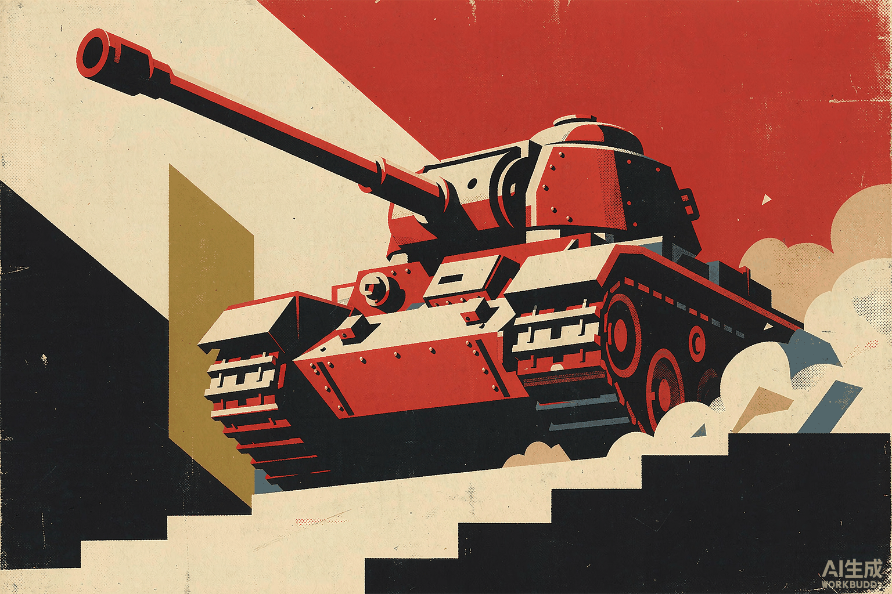
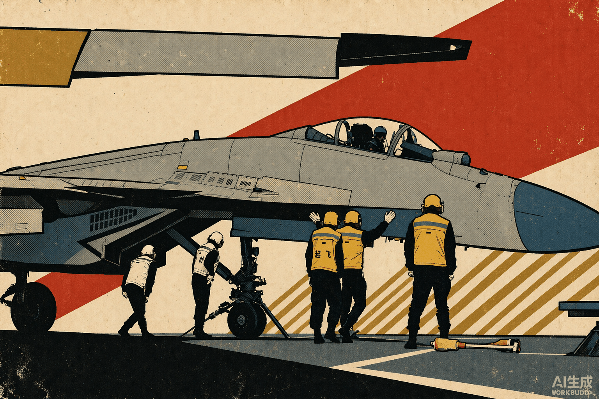
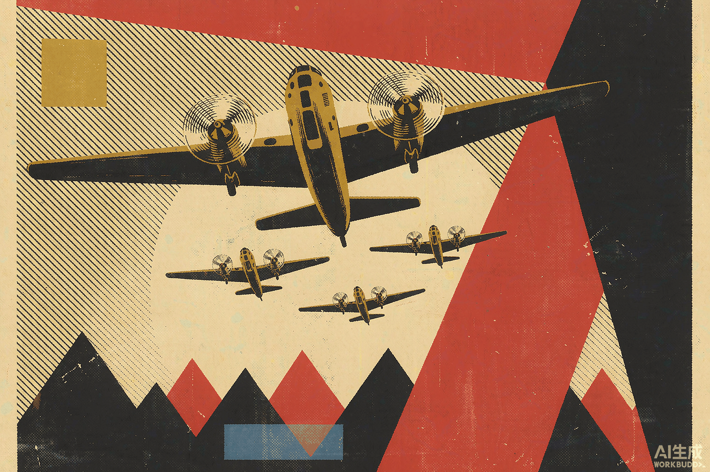

# Military Aesthetic · military-aesthetic

> Turn a real photograph into a 1930s Soviet constructivist military propaganda poster.
> The subject stays as it was; the entire background is rebuilt as geometry.


---

## Gallery

<table>
<tr>
<td width="33%"></td>
<td width="33%"></td>
<td width="33%"></td>
</tr>
<tr>
<td align="center"><sub>Tank · stepped diagonal (BG-2)</sub></td>
<td align="center"><sub>Carrier jet · photo to poster</sub></td>
<td align="center"><sub>Bomber formation · parallel hatch (BG-3)</sub></td>
</tr>
</table>

---

## Contents

- [What it solves](#what-it-solves)
- [What it is not](#what-it-is-not)
- [Style specification](#style-specification)
- [Three hard rules](#three-hard-rules)
- [Workflow](#workflow)
- [Background library](#background-library)
- [Prompt fragments](#prompt-fragments)
- [Troubleshooting](#troubleshooting)
- [Directory layout](#directory-layout)
- [Install & usage](#install--usage)
- [Limits](#limits)
- [License](#license)

---

## What it solves

The usual way to turn a casual equipment photo into a poster is to filter it, color-grade it, or wrap it in a border. The result is the same photo — just dirtier.

Military Aesthetic takes a different route: **keep the information in the photo, rebuild the grammar around it.**

- **The subject is preserved**: `input_fidelity: high` keeps airframe structure, deck-crew hand signals, folded-wing state and spatial relationships intact
- **The background is discarded**: sky, walls and clutter are replaced by a vermilion diagonal wedge, black terraces, an industrial skyline and parallel hatch lines on cream paper

What comes out is not "a filtered photo" — it is a poster that never existed.

## What it is not

| It is not | It is |
|-----------|------|
| A filter or a color grade | A recomposed frame, background rebuilt as geometry |
| A reproduction of text on the photo | Numbers and lettering flattened into solid color blocks |
| An open-ended re-imagining | Subject content strictly held to the original |
| Generic text-to-image | Five colors locked, geometric language locked, anti-rising-sun clause locked |

---

## Style specification

### Palette (hard cap of five)

| Role | Hex | Use |
|:-----|:-----|:-----|
| Paper | `#EFE5D2` | Warm cream, the dominant background tone |
| Vermilion | `#D22B1E` | Diagonal wedges, equipment body, accent blocks |
| Ink black | `#16130F` | Contours, silhouettes, large slabs |
| Ochre gold | `#C79131` | Lit metal faces, hatch lines, punctuation blocks |
| Steel blue | `#3E6E8C` | Accent only: sea, sky, shadow faces (≤10%) |

> Flat fills, no gradients — one color per shape. Depth comes from **juxtaposition**, never from shading.

### Form and line

- Bold black ink contours, loose pen-sketch strokes, slight wobble welcome
- Heavy where structure matters, light at detail — never an even outline
- Background auxiliary lines are **parallel**, never rays converging on a point

### Geometric language

| Element | Description |
|:--------|:------------|
| Diagonal slabs | 1–2 heavy bands or wedges cut the frame — the core constructivist move |
| Stepped terraces | Stairs, terraced fields, layered steps along the lower or side edge |
| Industrial skyline | Chimneys, cranes, water towers, rooftops in flat black silhouette |
| Parallel hatch | A band of thin lines all running in one direction |
| Perspective grid | Black / red / cream panels converging to a vanishing point |
| Angular mountains | Layered sharp triangles (for natural subjects) |

### Print texture

Visible halftone dots at color edges · paper grain throughout · slight color misregistration (1–2px at red/black boundaries) · scuffs and edge yellowing

> Aging must not swamp legibility. A dirty ground reads as "grimy", not "vintage".

---

## Three hard rules

### 1. No rising-sun language (instant fail)

**Any line structure that radiates outward from a single point is rejected.**

Red-and-white radial burst = the Japanese rising sun flag, an Axis military symbol. In military subject matter this is either a takedown or a serious problem — no amount of "Soviet" palette saves it.

| Forbidden | Replacement |
|:----------|:------------|
| sunburst / radiating rays | Parallel hatch lines (same direction) |
| sun / disc | None — no sun in the background |
| Fan of light bursting from behind the subject | Bold diagonal slabs and wedges |
| Radial circular emblem | Stepped geometry, rectangular blocks, wedges |

**Self-check**: the most prominent expanding structure in the frame must not be fan-shaped or radial.

### 2. No text of any kind

Slogans, numbers, letters, uniform insignia — all flattened into solid color blocks. Models reproduce text only as noise characters.

### 3. No decorative additions

Stamps, corner marks, "produced by" marks, borders and frames — anything absent from the reference gets nothing.

---

## Workflow

| Step | Action |
|:-----|:-------|
| 1 | **Pick a mode**: photo supplied → photo-to-poster (pass `image1`); otherwise generate from scratch |
| 2 | **Load the tool**: `ToolSearch(tool_names: ["ImageGen"])`, then call via `DeferExecuteTool` |
| 3 | **State the cost**: 5–10 credits per image and the planned count, before generating |
| 4 | **Describe the subject**: count, placement, facing, gestures, key structure — item by item |
| 5 | **Choose a background**: BG-1 … BG-4, replacing the photo's sky or clutter |
| 6 | **Attach three clauses**: text clause + anti-rising-sun clause + background layering clause |
| 7 | **Call**: `quality: high`, landscape `1536x1024` |
| 8 | **Inspect**: subject integrity → rising-sun check → background language → style → palette → texture → text → watermark |
| 9 | **Deliver**: `present_files` with the images only |

### Call parameters

```jsonc
// Photo to poster
{
  "image1": "<absolute path to the photo>",
  "input_fidelity": "high",        // below high, the subject gets redrawn beyond recognition
  "prompt": "<assembled prompt>",
  "quality": "high",
  "size": "1536x1024",             // portrait 1024x1536, square 1024x1024
  "output_dir": "<workspace>/generated-images/military-aesthetic"
}
```

---

## Background library

When converting a photo, **replace the original sky, walls and clutter entirely** with one of these pure geometric backgrounds.

| ID | Name | Best for | Character |
|:---|:-----|:---------|:----------|
| BG-1 | Industrial skyline | General default | Flat black Soviet factories, chimneys, cranes, water towers |
| BG-2 | Diagonal wedges + terraces | Most orthodox constructivism | Vermilion wedge, black slab, stepped base |
| BG-3 | Parallel hatch + mountains | Natural subjects | Same-direction thin lines, sharp triangular ridges |
| BG-4 | Perspective grid ground | Airfields / flight decks | Converging panels with a gold centerline |

---

## Prompt fragments

### Style block (reuse verbatim)

```text
Soviet constructivist military propaganda poster, 1930s Russian avant-garde screen-print style.

Render everything as flat unmodulated color blocks with hard-edged geometric shapes
and bold black ink outlines, no gradients, no shading, no volumetric rendering,
no photorealism, no metallic reflections.

Limited palette only: warm cream paper background (#EFE5D2), vermilion red (#D22B1E),
deep black (#16130F), ochre gold (#C79131), and a small amount of steel blue (#3E6E8C).

The composition is structured by bold diagonal geometry: the cream paper field is cut by
one large vermilion-red diagonal wedge and one deep-black diagonal slab, with parallel
diagonal hatch lines running in a single direction and stepped geometric terraces along
the lower edge. One small solid ochre-gold rectangle floats as a graphic accent.

Vintage offset print texture: visible halftone dot pattern, heavy paper grain,
slight color misregistration, weathered speckles and scuffs.
```

### Text clause (mandatory)

```text
Pure poster artwork, absolutely no text, no lettering, no numbers, no characters, no symbols,
no writing of any kind on any surface, no watermark, no signature, no border frame,
no patches, no badges, no uniform markings, no chest lettering, no insignia.
```

### Anti-rising-sun clause (mandatory)

```text
No sunburst, no radiating rays, no rays from a single point, no fan of light, no sun,
no circular emblem, no badge, no rising-sun motif, no radial composition.
The background contains no radiating or fan-shaped light pattern of any kind.
```

### Background layering clause (mandatory)

```text
All background geometry stays entirely behind the subject and never overlaps it.
The background elements are thin lines and hard-edged slabs placed in the upper left
and lower right areas, leaving open cream paper around the subject.
```

---

## Troubleshooting

| Symptom | Cause | Fix |
|:--------|:------|:-----|
| Background turns into a fan / disc | sunburst wording in the prompt | Remove radial wording + add the anti-rising-sun clause + **switch to a background scheme** (clauses alone are not enough) |
| Random characters on the airframe | Watermark or number in the source got repainted | Name "plain unlettered color blocks" in the subject + add no characters |
| Fake text on vests / uniforms | Insignia in the source photo | Write `plain solid vests with no patches, no writing` |
| Background slab lands on top of the wing | "Parallel hatch" rendered as a solid block | Add the layering clause + `thin lines, not solid slabs` |
| Subject redrawn beyond recognition | `input_fidelity` too low | Must be `high` + a detailed subject description |
| Muddy, dirty ground | Aging words weighted too heavily | Add `clean bright cream paper, minimal grunge` |
| Gradients, shading, metallic highlights | One of the four clauses missing | `no gradients, no shading, no volumetric rendering, no metallic reflections` |
| Distorted hands | Small faces and hands collapse under stylization | Keep 3–5 figures, write `flat silhouettes, no facial features` |
| Style drift across a batch | Prompt reworded each time | Copy the style and clause blocks verbatim |
| AI watermark bottom-right | Forced by the tooling layer | **Cannot be removed by prompt** — crop it out |

Full list of 11 in [`references/troubleshooting.md`](references/troubleshooting.md).

---

## Directory layout

Structure of the installed skill package (at `~/.workbuddy/skills/military-aesthetic/`):

```
military-aesthetic/
├── SKILL.md                      # main workflow (6 steps + inspection list + constraints)
├── README.md                     # Chinese version
├── README_EN.md                  # this file (English)
├── references/
│   ├── style-spec.md             # five-color spec + rising-sun red-line chapter
│   ├── prompt-templates.md       # 6 subject templates + background library + 3 clauses
│   └── troubleshooting.md        # 11 failure modes and their fixes
├── scripts/
│   └── contact_sheet.py          # contact sheet builder for batch review
└── assets/
    └── examples/                 # sample posters
```

This repository directory is the documentation and asset store: `README.md`, `README_EN.md`, `intro.md`, `examples/`.

---

## Install & usage

```bash
# Install (user scope, available across projects)
cp -r military-aesthetic ~/.workbuddy/skills/

# Build a contact sheet for batch review
python scripts/contact_sheet.py <image-dir> -o out.png --cols 3 --labels
```

**How to trigger**: hand over a photo plus a one-line description, or simply mention 军构美学 / 构成主义海报 / 军事宣传画 / 苏联海报风格.

---

## Limits

- Images come from a generative model and carry a **platform-level AI watermark** in the bottom-right corner; prompts cannot remove it, crop it out
- Text is never reproduced — only flattened into solid color blocks
- Batch runs require verbatim reuse of the style block, otherwise the style drifts
- Sample posters are model output, not photographic work

---

## License

Released under the **MIT License**. You are free to use, modify, merge, and distribute this work, including for commercial purposes. The only condition is that the original copyright notice and this permission notice are retained.

See [`LICENSE`](LICENSE) in the repository root for the full text.

```
Copyright (c) 2026 yingjun-zheng
```

---

<div align="center">
<sub>Spec in <code>references/style-spec.md</code> · Prompt library in <code>references/prompt-templates.md</code></sub>
</div>
